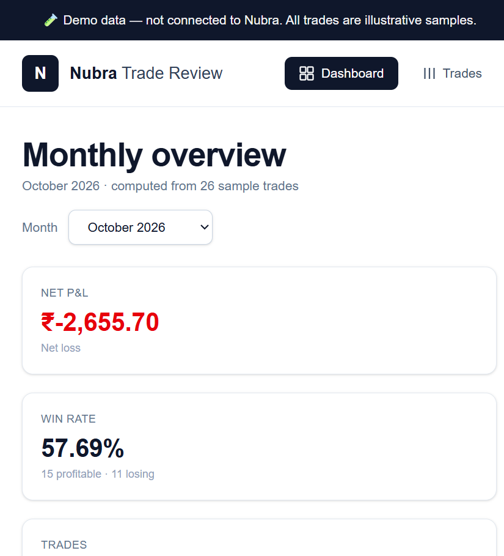
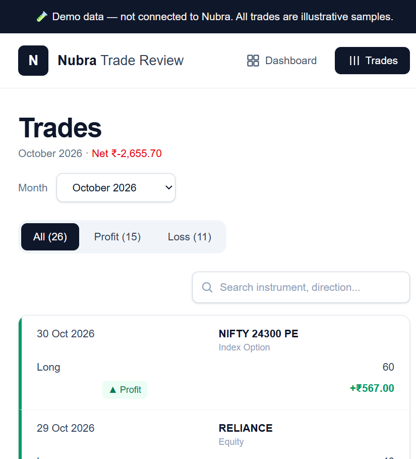
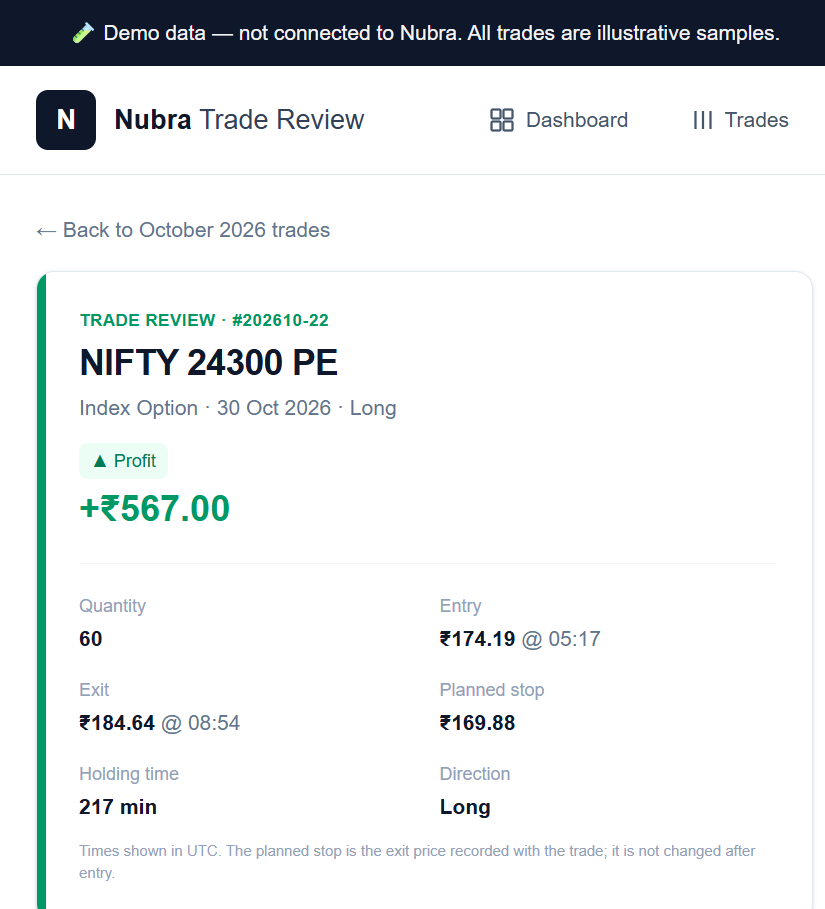

# Nubra Trade Review

> A monthly post-trade review app for retail traders. After the month ends, see what actually
> happened in each trade — entry, exit, size, timing, and whether the exit respected the planned
> stop — with every insight traceable to stored data.

**Live demo:** https://nubrareviewfeature.vercel.app
**As-built PRD:** [PRD.md](./PRD.md)
**Stack:** Next.js 16 (App Router) · TypeScript · Tailwind CSS · PostgreSQL (Neon) · Vercel

> 🧪 **Demo data only.** This build is not connected to Nubra. All trades are illustrative samples.

## Screens

| Monthly overview | Trades |
|---|---|
|  |  |

**Trade review** — timeline, stop-breach check, evidence-backed narrative:



---

## Why this exists

A retail trader finishes a month knowing the P&L number, but not *what actually happened*: which
trades went past the planned stop, where size was added, how long positions were held, and what is
worth re-checking next month.

Existing options are spreadsheets or dashboards that judge the trader ("you exited too early").
This product takes a different stance: **record observable facts, present them clearly, and let the
trader draw the conclusion.** No advice, no intent claims, no recommendations.

## What it does

| Screen | What the trader gets |
|---|---|
| **Monthly overview** (`/`) | Net P&L, win rate, completed trades, average P&L per trade, cumulative P&L and daily P&L charts, month selector |
| **Trades** (`/trades`) | Every closed trade for the month with profit/loss filters, server-side search, outcome badges and signed P&L |
| **Trade review** (`/positions/[id]`) | Order/fill timeline, entry → exit move, stop-breach check, auto-built "what happened" narrative with an evidence list, a reflection prompt, and a private note saved only in the browser |

## Product decisions

- **Facts in, analytics in the backend.** The database stores raw facts (positions, orders,
  executions). Every aggregate — monthly totals, win rate, cumulative P&L, stop-breach checks,
  narrative, timeline, reflection prompt — is computed server-side at request time. Nothing
  analytical is stored; nothing is computed on the frontend.
- **Frontend renders only.** No client-state library, no browser-side filtering or sorting.
- **Non-judgemental by design.** Findings are phrased as observable facts with disclaimers where
  wording could be read as interpretation. The reflection note never leaves the browser.
- **Every claim has evidence.** Each insight on the trade review page links back to the stored
  orders and executions that produced it.
- **Scope discipline.** v1 has no auth, no broker integration, and no monetisation. Those are
  explicit non-goals in the PRD, not forgotten features.

## Analytics rules (single source of truth)

| Metric | Definition |
|---|---|
| Winner / Loser | Realized P&L strictly > 0 / < 0. Break-even is neither. |
| Net P&L (month) | Sum of realized P&L for positions closed in the calendar month (UTC). |
| Win rate | Winners ÷ completed positions × 100, 2 dp, `null` when there are no trades. |
| Avg P&L per trade | Net P&L ÷ completed positions, 2 dp. |
| Stop breach | Long and exit < planned stop, or short and exit > planned stop. |
| Hold duration | Minutes between `opened_at` and `closed_at`. |

## API

All endpoints return JSON and compute results server-side.

| Endpoint | Purpose |
|---|---|
| `GET /api/months` | Months that have closed positions |
| `GET /api/months/{month}/analytics` | Monthly aggregates |
| `GET /api/months/{month}/daily-pnl` | Per-day and cumulative P&L |
| `GET /api/months/{month}/positions?outcome=profit\|loss&q=` | Filtered, searched trade list |
| `GET /api/positions/{id}` | Full trade review payload (timeline, evidence, narrative, prompt) |

## Run locally

```bash
git clone https://github.com/KoushikP1929/nubra_review_feature.git
cd nubra_review_feature
npm install
```

Create `.env.local` with a Neon PostgreSQL connection string:

```bash
DATABASE_URL=postgresql://<user>:<password>@<host>/<db>?sslmode=require
```

Then create the schema, load the sample trades, and start the app:

```bash
npm run db:setup
npm run dev
```

Open http://localhost:3000.

## How it was built

Designed and shipped **solo in a single ~5-hour build session** — problem framing → PRD → data
model → API → three screens → production deploy. `PRD.md` is the as-built v2.0 record of the final
scope, including the changes approved during the build.

## Out of scope (v1) and next

- Authentication and multi-user accounts
- Live broker / trading-API integration
- Server-side storage or sharing of reflection notes
- Real settlement/tax-grade P&L and corporate actions
- Next: cohort-level patterns across months, richer journaling, and an exportable monthly review

## Author

**Koushik P** — [LinkedIn](https://www.linkedin.com/in/koushik-p29041906/) ·
[GitHub](https://github.com/KoushikP1929) ·
[Portfolio](https://nextleap.app/portfolio/koushik)
